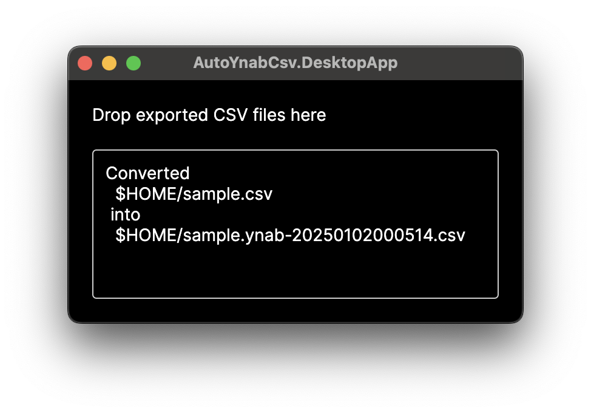

# auto-ynab-csv

> limited-use perpetual WIP automatic converter to [YNAB CSV](https://support.ynab.com/en_us/formatting-a-csv-file-an-overview-BJvczkuRq)

## Why?

- Account sync doesn't work for certain banks in YNAB.
- Some export formats require manual corrections even with available semi-automatic tools.
- Choosing the format manually should not be necessary.

## Usage

```shell
auto-ynab-csv {exported.csv} > {converted.csv}
```

replacing the placeholders accordingly.

Alternatively, let the app create a file next to the original one:

```shell
auto-ynab-csv convert --input {exported.csv}
```

A conversion is one step, not three. It echoes what it is about to do, then leaves one folder
next to the exports it read — `auto-ynab-report/<timestamp>/` — holding

- `index.html` — the searchable report to look at,
- `ynab/` — the rows to import into YNAB, one file per export,
- `audit.json` and `mail-index.json` — what was read, and what it was read from.

What a run prints, before any work and after it:

```text
Input:   7 export(s) in ~/Downloads/ynab-19oct2026
Output:  ~/Downloads/ynab-19oct2026/auto-ynab-report
Search:  on

Converting, indexing mail, and searching the mailbox for what it cannot explain…

Mail:    273 messages covering 2021-03-04 … 2026-10-18.
Found:   12 entries looked up, 34 mailbox hits, 9 matched, 3 bodies fetched.
Report:  ~/Downloads/ynab-19oct2026/auto-ynab-report/20261019-234524/index.html
Import:  ~/Downloads/ynab-19oct2026/auto-ynab-report/20261019-234524/ynab (7 file(s))
```

Every run gets its own timestamped folder, so nothing collides and yesterday's import is never
overwritten. The report is the same for one file and for a folder.

Pass a folder instead of a file and it converts the whole batch into one report:

```shell
auto-ynab-csv convert --input {folder-of-exports}
```

Add `--search` to let the conversion look in the mailbox for the entries the index cannot explain,
including messages that were never downloaded.

## GUI Usage

Drop the exported CSV files onto the app window. The report is written next to them, in
`auto-ynab-report/`, and opens from there.



## Mail-assisted payees and memos (macOS, optional)

Bank exports hide what a purchase was. YNAB will only ever see the row it imports, so the context
has to travel in the row itself: the **Payee** becomes the merchant, and the **Memo** carries the
gist of the mail — the items with their prices, the order number, and where the purchase really
happened (`via paypal`, `via kleinanzeigen`). If your mail is in Apple Mail, the converter reads it
locally, correlates purchases with the exported entries, and writes the enriched rows.

### Why the mail client, and never the mail account

The tool never talks to a mail server. It has no IMAP host, no password, no app token, no OAuth
consent — there is no account configuration in it at all. The mail client is the source of truth
for three things that are not ours to manage:

- **Configuration** — which accounts exist, which mailboxes, which filters and threads. Asking for
  an IMAP host would mean asking the user to describe their mail setup a second time, and to keep
  both descriptions in step.
- **Authorization** — the accounts on this Mac are already authorized, by the system and by the
  user, once. A tool that connected directly would own a second set of credentials: to store, to
  rotate, to fail closed on, and to leak.
- **Content** — a body that was never downloaded is on the server, and the mail client is the only
  thing allowed to fetch it. A direct connection can only see what the server exposes and would
  have to reimplement per-provider quirks (Gmail labels, Exchange, 2FA, app passwords).

Connecting directly is possible — MailKit does it well — but it turns a converter into an account
manager, and this tool does not manage accounts. So mail assistance is **macOS with Apple Mail
only**: the local store is read where it is, and bodies are fetched through Mail itself, with the
permission macOS asks for.

Everywhere else nothing breaks: the conversion, the report and the YNAB rows still come out of the
exports alone, and the run says which half is missing instead of pretending.

| | macOS + Apple Mail | Windows / Linux |
| --- | --- | --- |
| convert an export, report, YNAB rows | yes | yes |
| read messages, correlate, enrich payee and memo | yes | no |
| fetch a body that was never downloaded | yes, through Mail | no |
| `mail sync` / `mail scan` / `mail patterns` | yes | patterns only |

1. Grant **Full Disk Access** to the program you run (`auto-ynab-csv`, or VS Code/Terminal while
   developing) in System Settings → Privacy & Security → Full Disk Access.
2. Index the mail; later runs read only what changed, and a conversion does this by itself:

   ```shell
   auto-ynab-csv mail sync
   ```

   While developing, `./scripts/mail-sync.sh` does the same from source and tells you when the
   process it runs in has no Full Disk Access. An editor's integrated terminal usually does not;
   `./scripts/mail-sync.sh --via-terminal` retries inside Terminal.app, which may have it.

3. See the facts that were extracted:

   ```shell
   auto-ynab-csv mail scan --limit 50
   ```

   To write a pattern, look at what it has to match first. `mail text --match <words>` prints the
   plain text of every message that mentions something — an order number from the bank row, for
   instance:

   ```shell
   auto-ynab-csv mail text --match 028-1234567-8901234
   ```

   The index keeps facts and not bodies, so that text is read from disk when asked for.

4. Correlate an export and write draft rules:

   ```shell
   auto-ynab-csv mail correlate --input data/samples/dkb-giro.csv
   ```

5. Write the searchable report for a folder of exports:

   ```shell
   auto-ynab-csv mail export --input <folder>
   ```

   The report goes into `auto-ynab-report/<timestamp>/` next to the first export, with
   `index.html`, `audit.json`, `mail-index.json` and the importable rows in `ynab/`. Pass
   `--out <dir>` to put it somewhere else. Files this tool wrote earlier are not mistaken for
   exports on the next run.

   Each run gets its own timestamped folder. Besides `index.html`, `mail-index.json` and
   `audit.json` it holds `ynab/`, one YNAB CSV per export, ready to import:

   ```text
   Date,Payee,Memo,Inflow,Outflow
   2026-10-02,Thomann GmbH,"Saitensatz 10-52, 12,50 € · Order 12345678 · via thomann",0,177.29
   ```

   A memo is only filled with what the mail proves: without a confident match the row stays
exactly as the bank wrote it.

   The page searches every entry with AND over its words (prefixes, substrings and one typo
   count too). Every value in a result is labelled (`merchant:`, `amount:`, `order:`, `file:`,
   `facts:`), and a transaction is listed together with the mails that prove it — a query finds
   the pair, not two unrelated rows. The transfer graph sits behind a collapsible section and is
   drawn with [Mermaid](https://mermaid.js.org/) from a CDN; without a network the rest of the
   page still works.

   Only the mails a row was built from are on the page: the report is the evidence for what was
   imported, not a second copy of the mailbox. The audit block says how many of the indexed
   messages were kept.

   Rows link back into Apple Mail: every mail row, and every transaction whose row was built from
   a mail, has an `open in Mail` link. It is a `message://` URL made from the message's
   `Message-ID`, so it opens the exact message on this Mac.

### What the index covers

The index only knows what Mail has downloaded. `mail where` prints the oldest and newest message
it holds, and `mail sync` counts the stubs (`.partial.emlx`) Mail leaves for messages that are on
the server only. A stub keeps the headers and not the body, so `--search` reads the headers of
the stubs — the subject, the sender, the day — and never throws away a message that is only
there.

A conversion reads the span its exports cover, not the mailbox. The first row's day and the last
row's day decide how far back the store is read (with a week of margin, because a charge and its
mail can sit days apart), and only the facts inside that span are loaded for matching. Two runs
over different spans simply add to the same index — a differing span never clears it, since a
rebuild happens only when the patterns change or `mail sync --full` is asked for. Repeating a run
over the same span reads nothing again: every message is compared by file time and length before
it is parsed.

A long first sync reports its progress (`2,500/80,076 messages, 2,412 indexed, 0 already known, 0
unreadable`) and, when something cannot be read, names it — the file and the reason, five at a
time, so a broken container or a denied folder is something you can open instead of a bare
number.

The work survives an interruption. Messages are written in batches of 250 in one transaction, and
the rules fingerprint is recorded in the same transaction that clears the index for a rebuild —
so a run stopped with Ctrl-C keeps everything it had written, and the next start carries on
instead of clearing and parsing it all again (the counter then shows the messages as
`already known`).

For entries the index cannot explain at all, `--search` reads the stubs instead: the messages
whose body Mail still holds on the server. A stub is judged on what its headers say, and only
the ones whose day could still fit are offered — the query is built from what the entry itself
says, precise first:

- the **reference numbers** the transfer carries (digit runs of nine or more, e.g.
  `1050000000001`) — the number the confirmation quotes back, searched on its own;
- otherwise the **merchant** it names, but only inside the days the transaction allows, so a
  shop's newsletter from another month cannot stand in as evidence. A header says
  `Thomann Bestellung`, not `Thomann GmbH`, so the longest word of the name is what has to
  appear; the amount and the day still have to fit before anything is believed.

```shell
auto-ynab-csv convert --input <folder> --search
```

`--search` is also how messages that were never downloaded become evidence. Such a message has
headers on this Mac and its body on the server, so when a hit's date could still fit the entry,
Mail is asked for the body (AppleScript, `osascript`) — that makes Mail download it. The date is
checked first, a message that is already complete is never fetched, and each message is fetched at
most once per run. What the body yields — amounts, order numbers, vendor, the fields the rules
extract — is stored in the index; the body itself is not. macOS asks once for permission to
control Mail; without it, search still works and only bodies stay missing.

The index lives in `~/Library/Application Support/auto-ynab-csv/mail-index.sqlite`
(`%APPDATA%` on Windows, `$XDG_DATA_HOME` elsewhere). It is a cache: delete it and run
`mail sync` again at any time. Nothing is uploaded; mail never leaves the machine.

It is one SQLite file in WAL mode with `synchronous=NORMAL` and a five-second `busy_timeout`, so
the CLI and the app can touch it at the same time instead of failing on a lock. Search is
FTS5 over the tokenizer `unicode61 remove_diacritics 2 tokenchars '-_./'`: an order number or a
transaction code stays one token, so `028-1234567-8901234` is found as written, and `Händler`
matches `handler`. Queries are quoted word by word, so what you type cannot arrive as FTS5 syntax.

### Extending the patterns

Extraction rules turn mail patterns into named fields that matching can use. They are shipped as
one `patterns.jsonc` embedded in the binary — data, not code — so the rules that run are the rules
you can read. Copy them out and edit them:

```shell
auto-ynab-csv mail patterns --write      # -> ~/.config/auto-ynab-csv/patterns.jsonc
```

The shipped file is read first, then the same file name is laid over it, nearest wins:

- the executable's directory,
- `~/.config/auto-ynab-csv/patterns.jsonc`,
- the nearest `.auto-ynab-csv/patterns.jsonc` in a parent of the working directory.

Merging is **by rule id**, so a file with one rule replaces that rule and leaves the others
(`amazon.order`, `paypal.payment`, `thomann.order`, `db.booking`, `kleinanzeigen.sale`) alone, and
a rule with a new id is simply added. A copy in your config wins over a later change to the
shipped rule — delete it to get the shipped version back.

One field name is special: `items` keeps **every** match instead of only the first, one item per
line. That is what the memo lists; every other field keeps its first match.

The same file names the senders whose mail no rule matches, under `vendors`. It merges **by
domain**, so adding a shop is one line and renaming one is a one-line override:

```jsonc
{
  "version": 1,
  "vendors": { "kabelshop.example": "Kabelshop", "amazon.de": "Amazon (mine)" },
  "rules": [] // unchanged, and still the shipped ones
}
```

```jsonc
{
  "version": 1,
  "rules": [
    {
      "id": "amazon.order",
      "sender": "amazon\\.",
      "subject": "(Bestellung|Order|Versand|Rechnung|invoice)",
      "vendor": "Amazon",
      "fields": {
        "orderNumber": "\\b\\d{3}-\\d{7}-\\d{7}\\b",
        "total": "(?:Gesamtsumme|Gesamtbetrag|Order Total|Summe|Total)[^0-9]{0,20}(?:EUR|€)?\\s*([0-9]+[.,][0-9]{2})",
        "items": "(?m)^\\s*\\d{1,2}\\s*x\\s+(?<item>[^\\r\\n]+)$"
      }
    }
  ]
}
```

Invisible direction marks and non-breaking spaces are removed before any pattern runs, so an
order number that arrives as `Order # ‫028-1234567-8901234` is matched as if it were written
plainly.

`auto-ynab-csv mail patterns` shows the rules in effect, the fingerprint the index was built
with, and every place a file is looked for. Changing a rule rebuilds the index on the next
`mail sync`, because stored facts would otherwise be stale. So does a change to the way a
message's text is read — the reader's own version is part of the same fingerprint — and so does
`mail sync --full`. Everything else, including the phrases under `transfers` and how a memo is
written, takes effect on the next conversion without touching the index.

## Scripts

The scripts wrap the commands above and pass extra arguments straight through. The `.sh` and
`.bat`/`.ps1` twins do the same thing on macOS/Linux and Windows:

| what | bash | PowerShell |
| --- | --- | --- |
| build everything | `./scripts/build.sh` | `./scripts/build.ps1` |
| run the tests | `./scripts/test.sh` | `./scripts/test.ps1` |
| quality gate | `./scripts/quality-gate.sh` | `./scripts/quality-gate.ps1` |
| convert exports in place | `./scripts/convert.sh <folder>` | `./scripts/convert.ps1 <folder>` |
| convert with a mailbox search | `./scripts/convert.sh <folder> --search` | `./scripts/convert.ps1 <folder> -Search` |
| index mail from source | `./scripts/mail-sync.sh` | — |
| any `mail` command | `./scripts/mail.sh sync` | `./scripts/mail.ps1 sync` |
| report + YNAB CSVs | `./scripts/report.sh <folder>` | `./scripts/report.ps1 <folder>` |
| single-file packages | `./scripts/package.sh osx-arm64` | `./scripts/package.ps1 win-x64` |
| the CLI, raw | `./scripts/run.sh version` | `./scripts/run.ps1 version` |

```shell
./scripts/convert.sh ~/Downloads
```

### Quality gate

`./scripts/quality-gate.sh` runs every static check in one go and prints what to fix:

- `dotnet format` — formatting (advisory unless `--strict-format`),
- `dotnet build -warnaserror` — compiler warnings are errors,
- `dotnet test` with coverage — the suite must be green,
- **CRAP per method** — complexity and coverage combined (`scripts/crap.py`); above
  `--crap-threshold` (default 30) fails,
- **jscpd** — duplicate code above `--duplication` percent (default 3) fails.

CRAP and coverage reports land in `artifacts/quality-gate/`, which is git-ignored. Missing
tools are skipped with a note, never guessed.

For the layout of the code, when the index throws itself away and reads the mailbox again, and how
to add an extraction rule, see [docs/developer-guide.md](docs/developer-guide.md).

## Installation


### Download a Release

- pick a [release](https://github.com/d-led/auto-ynab-csv/releases).
- download the desired artifact && unpack.
- On OSX you might need to run `sudo xattr -d com.apple.quarantine auto-ynab-csv` on the downloaded binary.

### Build Yourself

```shell
./scripts/build.sh
```

See the output for the binary location.

To build a Mac App bundle:

```shell
./scripts/build-app.sh
```

To package one self-contained file per target (a single `.exe`/binary for the CLI and the app;
on macOS a single `.app` inside the archive, because macOS needs the bundle):

```shell
./scripts/package.sh                     # the current OS
./scripts/package.sh osx-arm64 win-x64   # explicit targets
```

## Currently Supported Export Formats

- [n26 Download](https://support.n26.com/en-eu/account-and-personal-details/bank-statements-and-confirmations/how-to-get-bank-statement-n26)
- DKB Giro (new) CSV
- DKB Visa (new) CSV

## Alternatives

- [github.com/aniav/ynab-csv](https://github.com/aniav/ynab-csv) - manual number format conversion necessary afterwards, manual clean-up of CSV of summary lines that don't conform to the format

## Structure

- [Converters, Detectors, Exporters](./AutoYnabCsv/)
- [Console App](./AutoYnabCsv.ConsoleApp/)
- [Unit and Approval Tests](./AutoYnabCsv.Tests/)
    - see [data/samples](./data/samples) for sample inputs
    - see `*.approved.txt` for approved converted files
